# CST8912 Lab 7

**Student Name**: Collin MacLeod
**Student ID**: macl0379
**Course**: CST8912 Cloud Solutions Architecture
**Semester**: Fall 2026

---

## Introduction

Cloud provider provides a variety of cloud services in a variety of cloud service models: IaaS, PaaS, and SaaS. When businesses migrate to the cloud, they must choose which model is best suited to their needs and is the most cost-effective. This course is designed to assist Cloud Architects in identifying their current cloud expenditures and providing greater awareness of the costs associated with each deployment model as well as each aspect of a cloud deployment.

Optimizing cloud costs begins with knowing your current cloud expenditures. This course introduces you to the tools built into the cloud Portal that can help you understand the total overall expenditures in cloud as well as break down those costs by area: Compute, Network, Storage, Identity, and App/Cloud Services.

The remainder of the course drills down on specific costs associated with each area of cloud identifies the costs associated with each service and provides very clear and concise methods for reducing cloud expenditures. Many of the cost savings methods will require minimal changes to your cloud deployment and will take just minutes to implement while other cost savings methods may take a shift in your cloud strategy, such as moving from Iaas to PaaS. 

---

## Screenshots

### Step 1 - Template Deployment

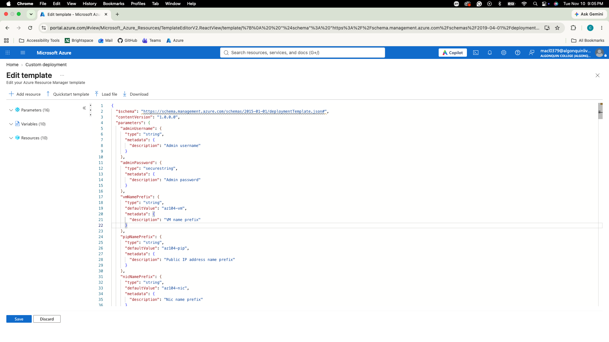
*Figure 1.1: Custom deployment template*

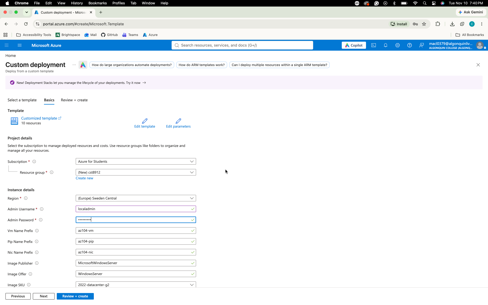
*Figure 1.2: Custom deployment parameters page with values*

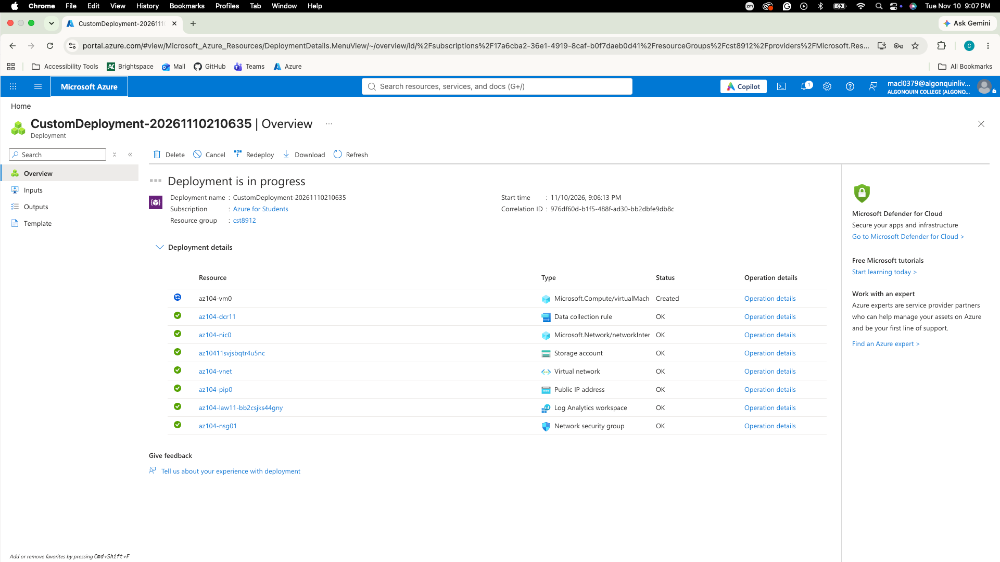
*Figure 1.3: Custom deployment in progress*

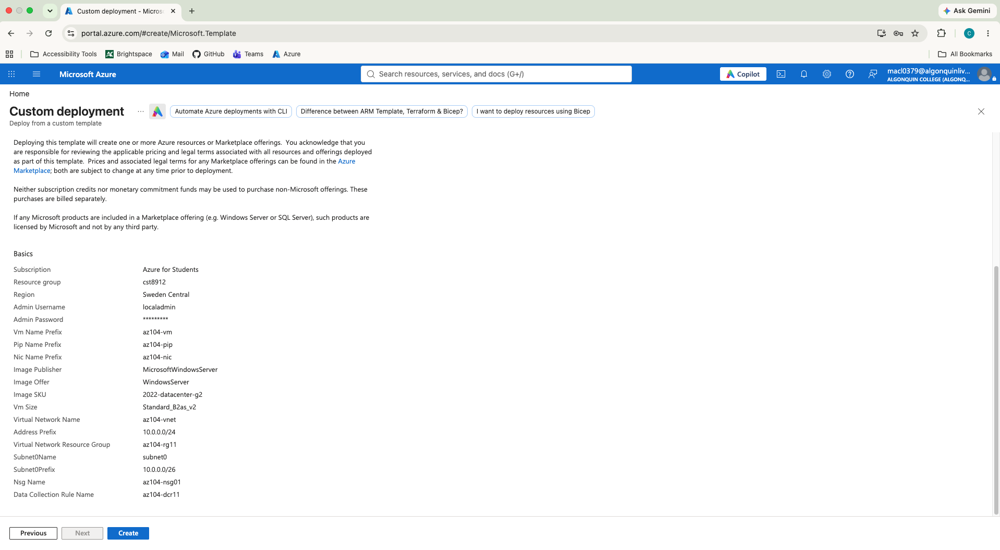
*Figure 1.4: Custom deployment review page*

### Step 2 - Create Alert Rule

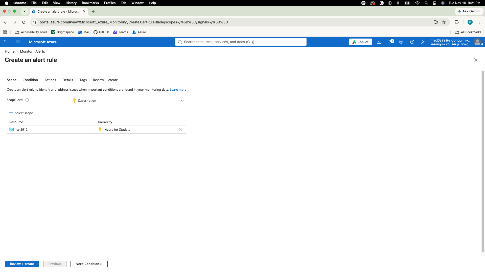
*Figure 2.1: Alert rule scope*

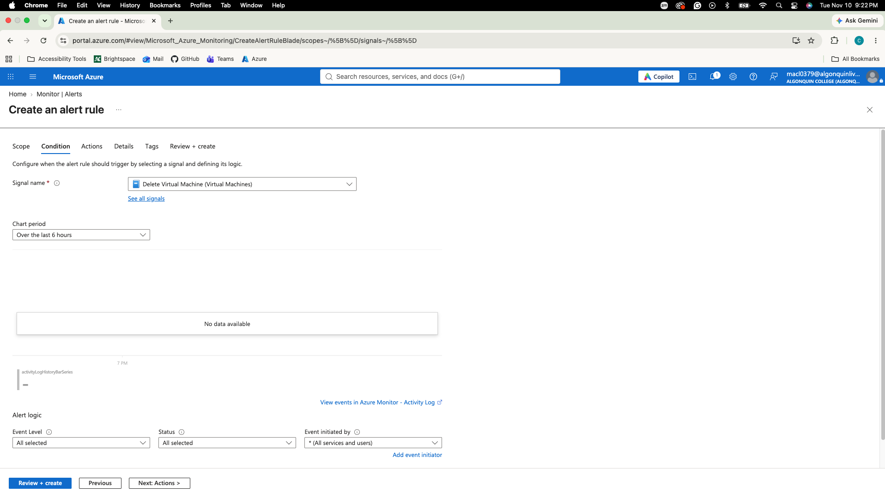
*Figure 2.2: Alert rule condition*

### Step 3 - Configure Action Group Notifications

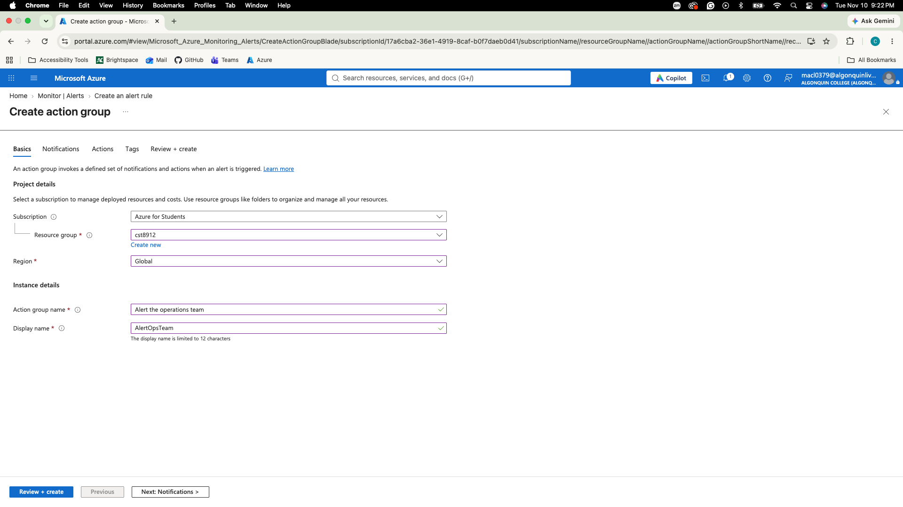
*Figure 3.1: Action group basics*

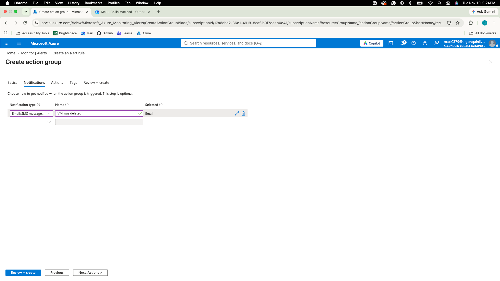
*Figure 3.2: Action group notifications*

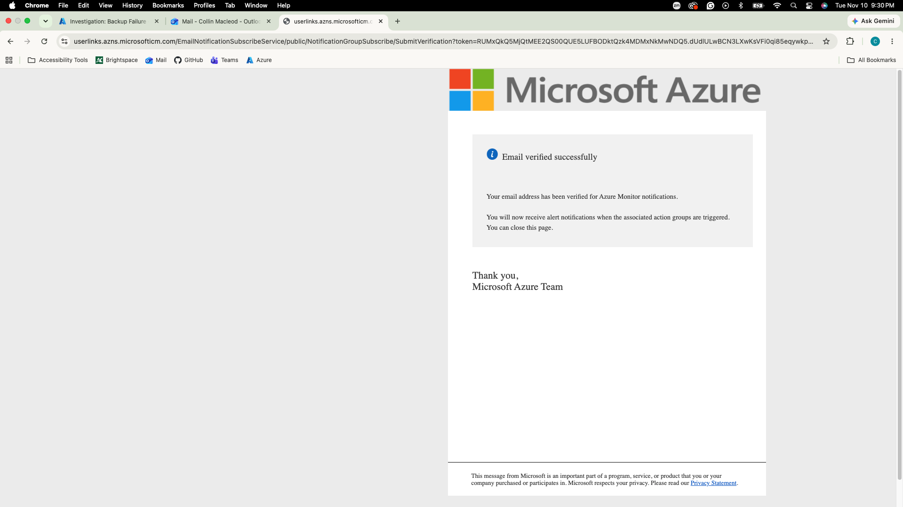
*Figure 3.3: Subscribed to notifications*

### Step 4 - Trigger Alert

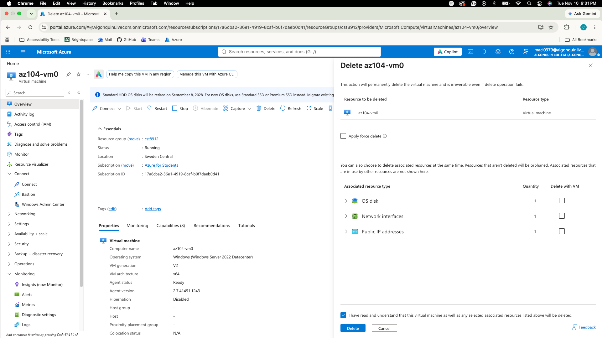
*Figure 4.1: Delete VM*

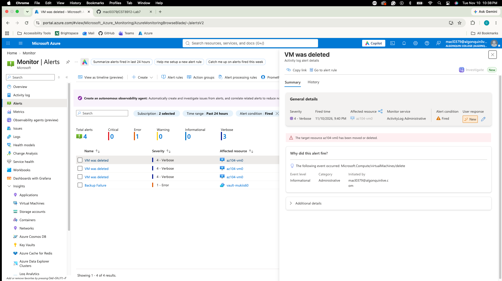
*Figure 4.2: Alert details*

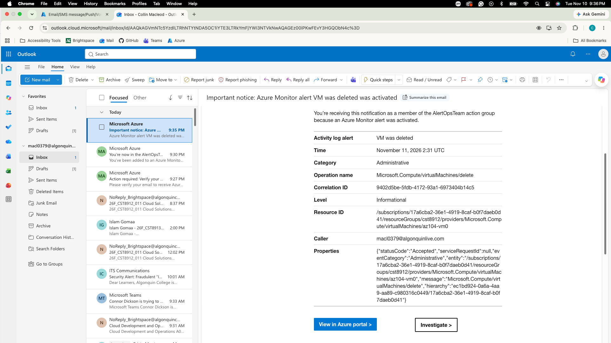
*Figure 4.3: Alert email*

### Step 5 - Configure Alert Proccessing Rule

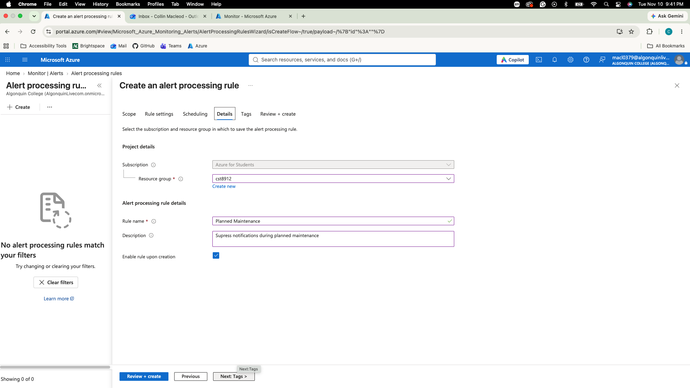
*Figure 5.1: Alert proccessing rule details*

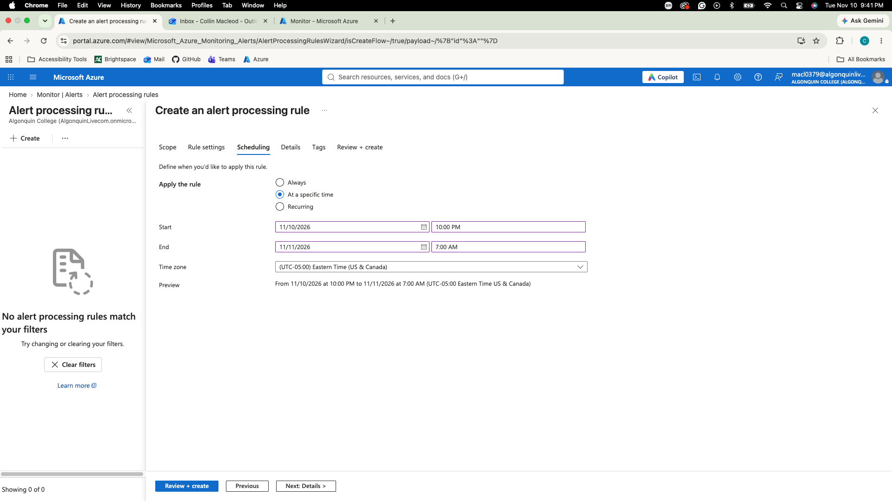
*Figure 5.2: Alert proccessing rule scheduling*

*Figure 5.3: Alert proccessing rule review*

### Step 6 - Azure Monitor Log Queries

*Figure 6.1: Heartbeat Count Query*

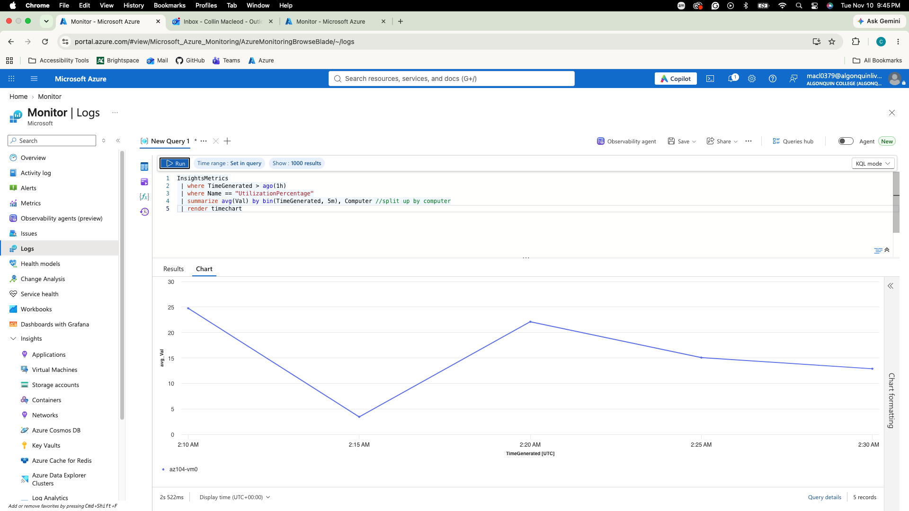
*Figure 6.2: Insight Metrics Query*

### Issues

In this lab I ran into 2 issues:

- When using the template to deploy the resources, I would receive alerts about vm quotas having a current limit of 0 (figure 7.1). To resolve this I used an azure CLI command to determine sizes that were similar in nature to the reccommended sizes that were available to me (figure 7.2).
- The alert was created three times and fired multiple emails and logged multiple times (figure 7.3). This would be an issue as it could clog logs and create possible confusion.

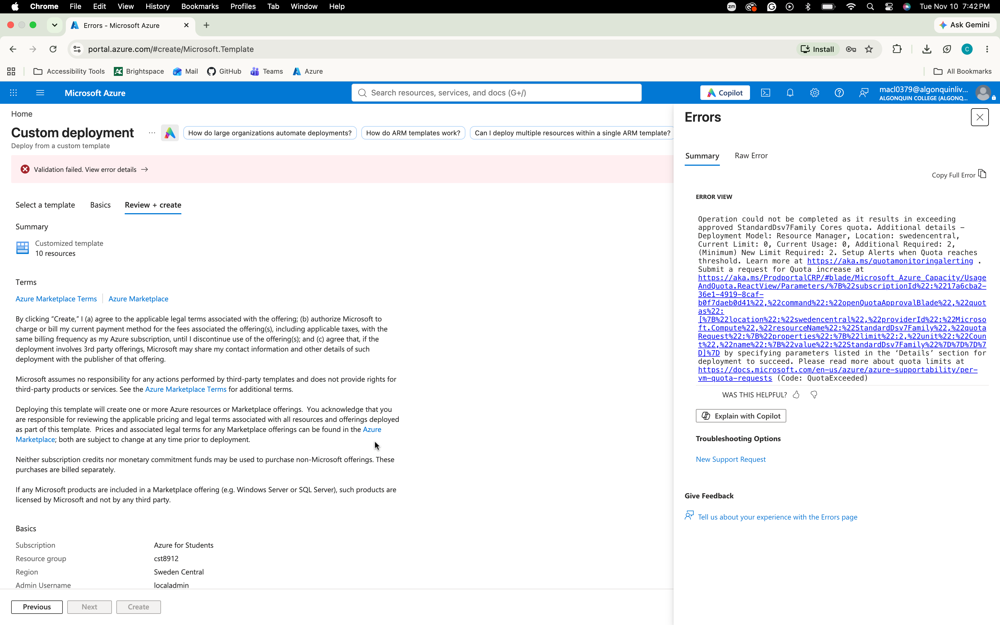
*Figure 7.1: VM quota error*

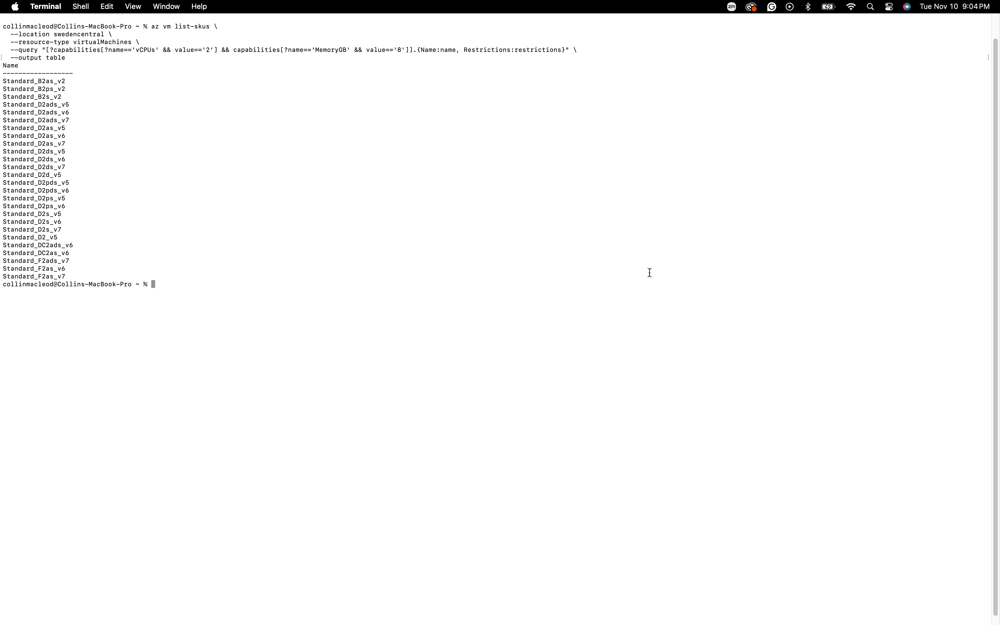
*Figure 7.2: Azure CLI command and output*

---

## Cleanup

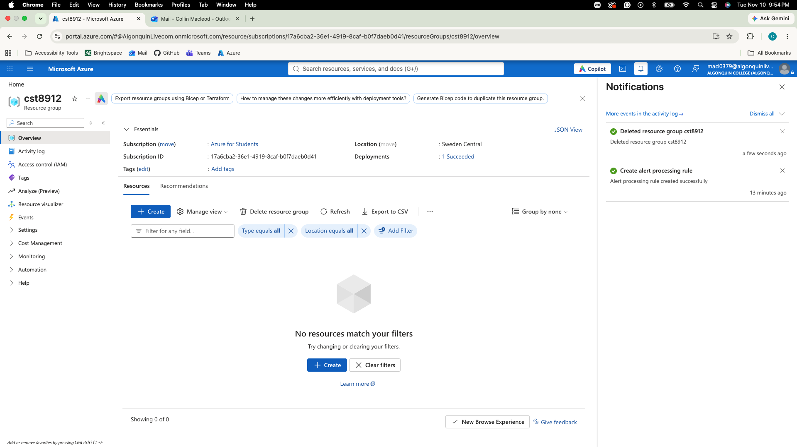
*Figure 8: Resource group cleanup*

